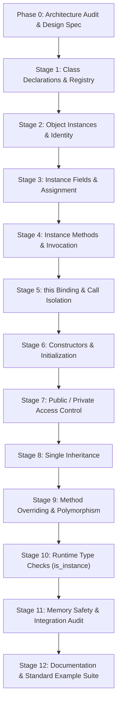

# BYKIG++ Object-Oriented Programming (OOP) Design Specification

**Phase 0 Architecture Audit & Comprehensive Design Reference**  
**Document Version:** 1.0.0  
**Authoritative Reference:** Governed by [`.agents/skills/bykigpp-oop/SKILL.md`](.agents/skills/bykigpp-oop/SKILL.md)

---

## Executive Summary

This document establishes the architectural audit, design principles, syntax specifications, runtime data structures, memory management rules, and phased implementation roadmap for adding Object-Oriented Programming (OOP) to **BYKIG++**.

BYKIG++ is a lightweight, dynamically interpreted language implemented in C. Its execution model is purely token-driven and source-position-driven: it uses linked lists, environments, call stacks, and direct file seeking (`ftell`/`fseek`) without an Abstract Syntax Tree (AST), bytecode compiler, or virtual machine.

In strict adherence to the project's identity, the OOP design detailed here:
1. **Extends rather than replaces** the existing C runtime structures (`Value`, `callFrame`, `envStack`, `whichone`, `resolve_complex_types`).
2. **Maintains 100% backward compatibility** with all non-OOP language features.
3. **Guarantees memory safety and call isolation**, specifically eliminating global mutable receiver state (`this`) to prevent corruption during nested and recursive method calls.
4. **Follows BYKIG++ syntax conventions** of clean whitespace-delimited tokens, spaced semicolons, and block formatting.

---

## 1. Architecture Audit & Current Implementation State

A thorough audit of the BYKIG++ codebase (`Interpreter.c`, `VarLL.h`, `ArithmaticExprEval.h`, `ExprEvalStack.h`, `Builtins.h`, `Keywords.h`, `BYKIG.c`, and `tests/`) was performed. The findings are summarized below.

### 1.1 Source-Processing & Interpreter Execution Flow

- **Main Loop (`run_interpreter_loop` in `Interpreter.c`)**:
  - Execution is driven by an infinite `while(1)` loop reading tokens from `FILE *fp` via `fscanf(fp, "%s", buffer)`.
  - Empty lines, whitespace, and `//` comments are skipped dynamically.
  - A standalone dot token (`"."`) at statement level acts as the explicit program terminator (`break`).
  - Reaching `EOF` also cleanly terminates execution.
- **Token Classification (`whichone` in `Keywords.h`)**:
  - `whichone(char *c)` performs string comparisons against known keywords (`int`, `float`, `char`, `if`, `while`, `func`, `return`, `list`, `map`, etc.) and returns an integer `mode`.
  - Mode `11` represents identifiers, variable names, or complex expressions.
  - An unrecognized token at statement level triggers `ERROR:` in `Interpreter.c`:
    `"Neither variable nor keyword nor function: \"%s\" (eof=%d, err=%d, ftell=%ld)!!!"`.
- **Block & Scope Execution (`{` and `}`)**:
  - Blocks track nesting depth using integer `p` and an array `c[1000]`.
  - An opening `{` (mode 28 or following control flow) increments `envTop++`, initializes a new `callFrame` via `initEnvironmentFrame(&envStack[envTop])`, and marks `blockEnv[p] = 1`.
  - A closing `}` (mode 7) frees the block's variables via `cleanupFrame(&envStack[envTop])`, decrements `envTop--`, and decrements `p`.
  - When `run_interpreter_loop` executes a function body, `p` starts at `-1`. When the function's terminating `}` is reached, `p < 0`, setting `break_loop = 1` and exiting the call loop.

### 1.2 Variable & Runtime Value Representation

- **Unified `Value` Model (`VarLL.h`)**:
  ```c
  enum ValueType {
      VAL_FLOAT,
      VAL_STRING,
      VAL_INT_ARRAY,
      VAL_FLOAT_ARRAY,
      VAL_CHAR_ARRAY,
      VAL_BOOL_ARRAY,
      VAL_LIST,
      VAL_MAP,
      VAL_ERROR
  };

  struct Value {
      enum ValueType type;
      float f;
      char s[1000];
      void *ptr;
  };
  ```
  - `VAL_FLOAT`: Numbers, booleans, and characters are represented numerically via `f`.
  - `VAL_STRING`: Strings are stored in `s[1000]`.
  - `VAL_LIST`, `VAL_MAP`, and typed arrays: Complex heap objects are referenced via `void *ptr`.
  - String serialization is handled uniformly by `value_to_string(struct Value v, char *dest, size_t dest_sz)`.
- **Variable Storage**:
  - Primitive and typed variables are organized as singly linked lists inside `struct callFrame`:
    - `IV` (`struct iV`): integers
    - `FV` (`struct fV`): floats
    - `CV` (`struct cV`): characters
    - `BV` (`struct bV`): booleans
    - `SV` (`struct sV`): strings
    - `IA`, `FA`, `CA`, `BA`: primitive arrays
    - `LV` (`struct lV`): dynamic lists
    - `MV` (`struct mV`): generic maps
- **Variable Lookup & Scoping**:
  - `typeFetcher(char *name)` and `valFetcherGlobal(char *name)` search from the current innermost environment down to global scope:
    ```c
    for (int idx = envTop; idx >= 0; idx--) { ... }
    ```
  - This structure inherently supports lexical shadowing and outer-scope mutation without duplication.

### 1.3 Function System & Call Stack

- **Function Registry (`funcDef` in `VarLL.h`)**:
  ```c
  struct funcParam {
      int type;
      char name[100];
  };

  struct funcDef {
      char name[100];
      int paramCount;
      struct funcParam params[10];
      long bodyPos;
      char filepath[1000];
      struct funcDef *next;
  };
  ```
  - Global linked list `struct funcDef *FN` stores all declared functions.
  - Functions are declared via `case 20` in `Interpreter.c`:
    - Parses parameter list `( type name , ... )`.
    - Captures file offset right after `{` via `long bodyPos = ftell(fp)`.
    - Captures the source file path via `filepath`.
    - Skips over the body tokens at declaration time by balancing braces (`{` and `}`).
- **Call Invocation & Recursion**:
  - Functions are invoked inside `resolve_complex_types()` in `ArithmaticExprEval.h` when an identifier is followed by `(`.
  - Arguments are evaluated sequentially using `val()`.
  - A new call frame is allocated: `callStackTop++`, recording `saved_envTop = envTop`.
  - A new environment frame is allocated: `envTop++`, initialized to empty.
  - Parameter variables are materialized in `envStack[envTop]`:
    - Primitives are passed by value.
    - Dynamic lists are passed by reference via `appendL_ref(&envStack[envTop].LV, paramName, callerList)`.
    - Maps and typed arrays are passed by value copy.
  - File position is managed: seeks to `func->bodyPos` in `funcFp` (opening `func->filepath` if from a module).
  - Invokes `run_interpreter_loop(funcFp, NULL)`.
  - On return (via `return` keyword / case 21 or reaching `}`):
    - Environment frames are unwound: `cleanupFrame(&envStack[e])` for all `e > saved_envTop`.
    - `envTop = frame->saved_envTop`.
    - `callStackTop--`.
    - Return value is substituted back into the expression token stream.

### 1.4 Expression Evaluation Pipeline

- Expressions are handled in two stages without an AST:
  1. **Complex Resolution (`resolve_complex_types` in `ArithmaticExprEval.h`)**:
     - Tokenizes expression string handling quotes, spaces, and brackets.
     - Resolves built-in functions (`findBuiltin`) and user functions (`findFunc`).
     - Resolves multi-dimensional and nested indexing: `arr[i]`, `list[i]`, `map[key]`, `data[0]["user"][1]`.
     - Rewrites resolved items in-place into primitive numbers or formatted string tokens (`format_string_token`).
  2. **Stack-Based Postfix Evaluation (`val` in `ArithmaticExprEval.h`)**:
     - Converts infix to postfix using operator stack (`struct node *Stack`).
     - Translates multi-character operators (`==` to `#`, `!=` to `@`, `<=` to `^`, `>=` to `?`, `&&` to `&`, `||` to `|`).
     - Evaluates postfix tokens using `Value` stack (`struct node2 *PFEval`).
     - Supports arithmetic, string concatenation, and comparison.

### 1.5 Module System (`use`)

- `use "path.bykig" ;` (case 24 in `Interpreter.c`):
  - Resolves path relative to the current file.
  - Temporarily sets `current_fp = mod_fp` and executes `run_interpreter_loop(mod_fp, resolved_path)`.
  - Functions defined in modules record the module's path in `funcDef.filepath`, allowing future calls to reopen the file and seek to `bodyPos`.
  - Code runs directly in the current environment rather than an isolated namespace.

### 1.6 Current Test Suite & Baseline

- **Harness**: `tests/run_tests.py` runs 79 `.bykig` test files across `basics/`, `control_flow/`, `data_structures/`, `functions/`, `modules/`, `integration/`, and `errors/`.
- **Baseline Results**:
  - Total: **79**
  - Passed: **77** (97.5%)
  - Failed: **0**
  - Hung / Timeout: **2** (Pre-existing)
    - `tests/misc/Try.bykig`: Hung due to interactive console input (`in n ;`) blocking on EOF/stdin.
    - `tests/functions/overflow_test.bykig`: Hung due to deep recursion stress testing system file descriptor and stack limits.
- **Build Method**:
  ```powershell
  gcc -O2 -Wall -o Interpreter.exe Interpreter.c
  ```
  Compiles cleanly with standard GCC on Windows.

### 1.7 Existing OOP Constructs

- **Audit Result**: Zero OOP constructs exist in the C interpreter runtime or headers.
- `mini-bykig++` contains a conceptual "heap object" abstraction implemented as associative maps (`memory.bykig`), but the native C interpreter has no classes, instances, methods, or `this` binding.

---

## 2. Reusable Foundations & Extension Strategy

BYKIG++'s existing architecture provides clean, robust extension points that allow OOP to be integrated naturally:

| Foundation Component | Existing Responsibility | OOP Extension Strategy |
|---|---|---|
| `enum ValueType` | Distinguishes runtime value types | Add `VAL_OBJECT` (value 8) to represent object instances. |
| `struct Value` | Transports values through expressions | Use `ptr` for `struct objInstance*`. The `f` field is never overloaded for object IDs. |
| `struct callFrame` | Represents call and environment frames | Add `struct oV *OV` for object variable bindings; add `struct objInstance *thisObj` for receiver tracking; add `struct classDef *executingClass` for private access checks. |
| `cleanupFrame()` | Reclaims frame memory | Reclaims local variable nodes (`struct oV`) without destroying the underlying heap-allocated instances. |
| `struct funcDef` | Function metadata & source location | Reused directly as the underlying execution engine for instance methods and constructors. |
| `resolve_complex_types()` | Resolves function calls and indexing | Extended to resolve method invocations (`obj . method ( args )`) and field access (`obj . field`). |
| `whichone()` / `Keywords.h` | Token-to-mode mapping | Add modes for `class` (29), `new` (30), `this` (31), `public` (32), `private` (33), `extends` (34). |
| `case 11` in `Interpreter.c` | Statement identifiers & assignments | Extended to handle member assignment (`obj . field = expr ;` and `this . field = expr ;`). |

---

## 3. Proposed BYKIG++ OOP Syntax Conventions

BYKIG++ enforces clean token spacing where punctuation and operators are separated by whitespace. All OOP syntax decisions follow this established convention.

### 3.1 Class Declaration

```bykig
class Point
{
    public float x ;
    public float y ;

    public func construct ( float initialX , float initialY )
    {
        this . x = initialX ;
        this . y = initialY ;
    }

    public func getX ( )
    {
        return this . x ;
    }

    public func setX ( float newX )
    {
        this . x = newX ;
    }
}
```

### 3.2 Single Inheritance

```bykig
class Animal
{
    public string name ;

    public func construct ( string n )
    {
        this . name = n ;
    }

    public func speak ( )
    {
        return "Generic sound" ;
    }
}

class Dog extends Animal
{
    public string breed ;

    public func construct ( string n , string b )
    {
        this . name = n ;
        this . breed = b ;
    }

    public func speak ( )
    {
        return "Woof" ;
    }
}
```

### 3.3 Object Instantiation & Constructor Semantics

- **Constructor Naming**: All explicit constructors are declared using the fixed name `construct`:
  ```bykig
  public func construct ( float initialX , float initialY )
  {
      this . x = initialX ;
      this . y = initialY ;
  }
  ```
- **Instantiation**: Instantiation uses the `new` keyword followed by the class name and constructor arguments:
  ```bykig
  Point p = new Point ( 10.5 , 20.0 ) ;
  Dog d = new Dog ( "Buddy" , "Golden" ) ;
  ```
- **Zero-Argument Default Initialization**: If a class does not define an explicit `construct` method, instantiation with zero arguments (`new ClassName ( )`) is automatically supported, initializing all declared fields to default values (primitives to `0` / `0.0`, booleans to `0`, characters to `'\0'`, strings to `""`, collections and object references to `NULL`). Passing arguments to a class without an explicit constructor is a runtime error.
- **Inheritance & Constructor Chaining Scope**:
  - Automatic superclass-constructor chaining is **NOT** performed.
  - `super` invocation is **outside the initial roadmap**.
  - In single inheritance (Stage 8), derived classes inherit field definitions and default initializers from the superclass. When a derived class defines `construct`, it directly initializes its instance state (including inherited fields via `this . field = ...`). Calling superclass constructors is not automated.

### 3.4 Member Access & Method Invocation

Both spaced (`obj . member`) and unspaced (`obj.member`) syntax are supported. Spaced syntax aligns with standard BYKIG++ style:

```bykig
// Field access & mutation
p . x = 15.0 ;
out p . x + "%n" ;

// Method invocation
string sound = d . speak ( ) ;
out sound + "%n" ;

// Method invocation on this inside class
this . setX ( 42.0 ) ;
```

### 3.5 Disambiguation of Dot (`.`)

In BYKIG++, a standalone `.` token on its own line indicates the program terminator.
- A `.` preceded by an object reference or variable name (`obj . field`) is a member operator.
- A `.` surrounded by digits (`3.14`) is a floating-point literal.
- A solitary `.` token as the first token of a statement terminates the program.
There is zero grammatical ambiguity between these forms.

---

## 4. Minimal Proposed Runtime Data Structures

The proposed runtime structures are minimal, data-structure-driven, and integrate directly with existing headers.

### 4.1 Class Definitions & Method Metadata

Fixed-capacity limits are enforced with explicit bounds checks to eliminate any risk of buffer overflow during class declaration or inheritance:

```c
#define MAX_CLASS_FIELDS 64
#define MAX_CLASS_METHODS 64

struct classField {
    char name[100];
    int type;          // 1=int, 2=float, 3=char, 4=bool, 5=string, 6=intarr, 7=floatarr, 8=chararr, 9=boolarr, 10=list, 11=map, 12=object
    int isPrivate;     // 0=public, 1=private
};

struct classMethod {
    char name[100];
    int isPrivate;     // 0=public, 1=private
    struct classDef *declaringClass; // Class that declared this method (used for private access checks)
    struct funcDef *func;
};

struct classDef {
    char name[100];
    char parentName[100];
    struct classDef *parent;          // Resolved pointer to superclass (or NULL)
    
    struct classField fields[MAX_CLASS_FIELDS];
    int fieldCount;                   // Strictly bounded: <= MAX_CLASS_FIELDS
    
    struct classMethod methods[MAX_CLASS_METHODS];
    int methodCount;                  // Strictly bounded: <= MAX_CLASS_METHODS
    
    struct funcDef *constructor;      // Pointer to construct funcDef (or NULL)
    struct classDef *next;
};

extern struct classDef *CLASS_REGISTRY;
```

#### Capacity Overflow Prevention:
- When parsing a class field: if `fieldCount >= MAX_CLASS_FIELDS`, the interpreter emits:
  `"Error: Class '%s' exceeds maximum field capacity of %d\n"`, aborting declaration.
- When inheriting fields: if `child->fieldCount + parent->fieldCount > MAX_CLASS_FIELDS`, the interpreter emits:
  `"Error: Class '%s' exceeds maximum inherited field capacity of %d\n"`, aborting declaration.
- When parsing a class method: if `methodCount >= MAX_CLASS_METHODS`, the interpreter emits:
  `"Error: Class '%s' exceeds maximum method capacity of %d\n"`, aborting declaration.

### 4.2 Object Instance & Instance Storage

Instances are allocated on a runtime-owned heap and reference their fields through a dynamically sized buffer sized exactly to `cls->fieldCount`:

```c
struct objFieldVal {
    char name[100];
    int type;                         // Field type (1..12)
    struct Value val;                 // Unified runtime Value representation
};

struct objInstance {
    int id;                           // Unique integer instance ID for identity diagnostics and equality
    struct classDef *cls;             // Pointer to class definition
    int fieldCount;
    struct objFieldVal *fields;       // Dynamically allocated array: calloc(fieldCount, sizeof(struct objFieldVal))
    struct objInstance *next;         // Linked in global runtime-owned heap (OBJECT_HEAP)
};

extern struct objInstance *OBJECT_HEAP;
extern int NEXT_OBJECT_ID;
```

### 4.3 Object Variable Storage in Frames & Method-Owner Tracking

In `struct callFrame` (`VarLL.h`):

```c
struct oV {
    char name[100];
    struct objInstance *instance;     // Non-owning reference to heap instance
    struct oV *next;
};

struct callFrame {
    // Existing primitive & collection lists:
    struct iV *IV; struct fV *FV; struct cV *CV; struct bV *BV; struct sV *SV;
    struct iA *IA; struct fA *FA; struct cA *CA; struct bA *BA;
    struct lV *LV; struct mV *MV;
    
    // OOP frame extensions:
    struct oV *OV;                    // Object variable storage for this scope
    struct objInstance *thisObj;      // Active receiver instance for this method invocation
    struct classDef *executingClass;  // Declaring class (owner) of the currently executing method
    
    // Existing call-stack tracking fields:
    long returnPos; 
    int hasReturn; 
    struct Value returnValue;
    int saved_p;
    int saved_k;
    int saved_envTop;
    int savedVarCount;
    int assignType;
    char assignTarget[100];
};
```

---

## 5. Object Lifecycle, Identity & Memory Safety

### 5.1 Object Identity & Reference Semantics
- Variables holding objects store a pointer to `struct objInstance` via `v.type = VAL_OBJECT` and `v.ptr = (void*)instance`.
- **Identity Representation**:
  - The floating-point field `v.f` is **never** used to store or transport unique IDs or pointers.
  - `objInstance.id` (an integer) provides readable unique IDs for diagnostics, debugging, and string formatting (e.g. `<Object Point#1>`).
  - Object identity comparison (`a == b` or `a ~ b`) is determined strictly by pointer identity (`v1.ptr == v2.ptr`) or integer ID comparison (`inst1->id == inst2->id`).
- Assignment (`Point b = a ;`) copies the pointer reference (`VAL_OBJECT`), creating an **alias**. Mutations to `b . x` immediately reflect in `a . x`.
- Distinct objects created via separate `new` invocations have distinct pointers and IDs (`inst1 != inst2`).

### 5.2 Allocation & Field Initialization
- Instantiation via `new ClassName ( ... )`:
  1. Looks up `classDef` in `CLASS_REGISTRY`.
  2. Allocates `struct objInstance` on heap with unique integer `id = NEXT_OBJECT_ID++`.
  3. Pre-allocates `inst->fields` array using `calloc(cls->fieldCount, sizeof(struct objFieldVal))`.
  4. Copies field names and types from `cls->fields` (including inherited superclass fields).
  5. Initializes fields to default zero values (primitives to `0` / `0.0`, strings to `""`, collections and object references to `NULL`).
  6. Prepends the instance into the global runtime-owned `OBJECT_HEAP`.
  7. Executes the `construct` method if defined, binding `this` to the newly allocated instance. If no `construct` method is defined, zero-argument instantiation succeeds automatically.
  8. Returns `struct Value` with `type = VAL_OBJECT` and `ptr = instance`.

### 5.3 Safe Runtime-Owned Heap Ownership Strategy
- **Why Reference Counting Was Rejected**:
  Naive reference counting cannot safely reclaim objects without every reference creation and release being tracked across all runtime locations: local variables, call frames, object fields (`inst->fields`), dynamic lists (`struct lV`), generic maps (`struct mV`), and expression evaluation stacks (`struct node2 *PFEval`). Any untracked reference causes premature deallocation and dangling-pointer crashes.
- **The Safe Ownership Invariant**:
  1. **Heap Ownership**: The global linked list `OBJECT_HEAP` owns all allocated `struct objInstance` structures for the duration of program execution.
  2. **Non-Owning References**: Variables in scopes (`struct oV`), object fields, collection items, and expression stacks hold non-owning references (`struct objInstance *`).
  3. **Scope Cleanup**: When a block or function terminates, `cleanupFrame()` frees the frame-local `oV` variable nodes (reclaiming the names), but leaves the underlying heap-allocated instances intact.
  4. **Cyclic Reference Safety**: Cyclic object references (`a . b = b ; b . a = a ;`) remain safely allocated on `OBJECT_HEAP` throughout execution without risk of double-freeing or premature reclamation.
  5. **Deterministic Teardown**: At interpreter shutdown (or program termination when reaching `.` or EOF), `freeAllObjects()` traverses `OBJECT_HEAP`, freeing each instance's `fields` buffer and the instance itself.

---

## 6. Method Dispatch, Polymorphism & Inheritance

### 6.1 Single Inheritance & Hierarchy Setup
- A class may optionally inherit from a single superclass: `class Child extends Parent`.
- When `Child` is declared, its `parent` pointer is linked to `Parent` in `CLASS_REGISTRY`.
- Circular inheritance (e.g. `A extends B`, `B extends A`) is checked and rejected at declaration time.
- All superclass fields are merged into the child class's field layout.

### 6.2 Virtual Method Dispatch
When `receiver . methodName ( args )` is called:
1. The receiver expression is evaluated to obtain `struct objInstance *inst`.
2. Dispatch starts at the dynamic runtime class: `struct classDef *curr = inst->cls`.
3. Traverses upward:
   ```c
   while (curr != NULL) {
       for (int m = 0; m < curr->methodCount; m++) {
           if (strcmp(curr->methods[m].name, methodName) == 0) {
               // Method found: verify access control and dispatch
               return executeMethod(curr->methods[m].func, inst, args);
           }
       }
       curr = curr->parent;
   }
   ```
4. If no matching method is found anywhere in the hierarchy, execution raises:
   `"Error: Method '%s' not found in class '%s'\n"`.

### 6.3 Method Overriding & Polymorphism
- If `Dog` overrides `speak()` declared in `Animal`, lookup starting at `inst->cls` (`Dog`) immediately finds `Dog`'s implementation, achieving runtime polymorphism.
- Calling `animal . speak()` executes `Dog`'s version whenever the underlying instance is a `Dog`.

---

## 7. Receiver (`this`) Binding & Call Stack Isolation

### 7.1 The Global Pointer Risk & Resolution
- **Critical Risk**: Using a global variable like `FILE *current_receiver` causes clobbering whenever method calls are nested (`a . foo ( b . bar ( ) )`) or recursive (`this . walk ( n - 1 )`).
- **Architectural Solution**: Store the receiver strictly inside the call frame:
  ```c
  callStack[callStackTop].thisObj = receiverInstance;
  ```
- In addition, materialize a local variable `"this"` in the method's own environment frame:
  ```c
  appendObj(&envStack[envTop].OV, "this", receiverInstance);
  ```

### 7.2 Call & Return Invariant
1. Before calling a method, `callStackTop++` pushes a new frame and stores `frame->thisObj = receiver`.
2. Inside the method body, any reference to `this` reads from `envStack[envTop]` or `callStack[callStackTop].thisObj`.
3. When the method completes, `callStackTop--` automatically restores the caller's receiver.
4. No global pointer is ever mutated, guaranteeing reentrancy and recursion safety.

---

## 8. Encapsulation & Access Control Rules

### 8.1 Visibility Specifiers
- `public`: Member is accessible from any context (inside or outside the class).
- `private`: Member is accessible ONLY from methods defined within the declaring class.
- Default: Members without an explicit access specifier default to `public`.

### 8.2 Access Verification Logic & Method Owner Resolution

#### The Inherited-Method Risk:
Checking access using `thisObj->cls` is fundamentally incorrect when inheritance is involved. Consider:
- Base class `Parent` defines `private int secret ;` and a public method `getSecret() { return this . secret ; }`.
- Derived class `Child extends Parent` inherits `getSecret()`.
- An instance `c = new Child() ;` calls `c . getSecret()`.
- During execution of `getSecret()`, `thisObj->cls` is `Child`.
- If the access checker compared `thisObj->cls` against the declaring class (`Parent`), it would see `Child != Parent` and illegally **deny** `getSecret()` access to its own class's private field!
- Conversely, if a method in `Child` called `this . secret`, a naive check might falsely allow it if only looking at the instance type.

#### The Correct Method-Owner Invariant:
Private access checks must verify against the **declaring class of the currently executing method**, which is tracked in `callStack[callStackTop].executingClass`.

```c
// When invoking any method:
callStack[callStackTop].executingClass = method->declaringClass;

// When accessing target . member (field read, field write, or method call):
if (member->isPrivate) {
    struct classDef *callerContext = (callStackTop >= 0) ? callStack[callStackTop].executingClass : NULL;
    if (callerContext != memberDeclaringClass) {
        printf("Error: Cannot access private member '%s' of class '%s' from context '%s'\n",
               memberName, memberDeclaringClass->name, callerContext ? callerContext->name : "<global>");
        // Abort execution or produce runtime error Value
        return errorVal;
    }
}
```
- If access is attempted from global code or a non-method function, `callerContext` is `NULL`, correctly denying access.
- If access is attempted from a method defined within `memberDeclaringClass`, `callerContext == memberDeclaringClass`, correctly permitting access regardless of the dynamic subclass of `thisObj`.

---

## 9. Staged Implementation Roadmap (Stages 1 – 12)

The 12 development stages are planned in sequential dependency order. Each stage is self-contained, reviewable, and test-driven.



---

### Stage 1: Class Declarations & Registry ✅ [IMPLEMENTED & TESTED]
- **Status**: Complete. Class declarations parsing (`case 29`), `CLASS_REGISTRY`, `struct classField`, `struct classMethod`, `struct classDef`, capacity bounds checks (`MAX_CLASS_FIELDS`, `MAX_CLASS_METHODS`), duplicate rejection, and `class_exists` built-in implemented and verified.
- **Purpose**: Allow parsing and storing class declarations without instantiating them.
- **Dependencies**: None (builds on Phase 0 audit).
- **Runtime Structures**: `struct classField`, `struct classMethod`, `struct classDef`, `CLASS_REGISTRY`.
- **Parser Changes**: Mode for `class` in `Keywords.h`; parsing header, body token skipping balancing braces.
- **Compatibility Concerns**: Must not interfere with normal variable or function declarations.
- **Edge Cases**: Empty class `{ }`, duplicate class name rejection, invalid tokens in class body.

### Stage 2: Object Instances & Identity ✅ [IMPLEMENTED & TESTED]
- **Status**: Complete. `VAL_OBJECT` added to `enum ValueType`; `struct objFieldVal`, `struct objInstance`, `OBJECT_HEAP`, `NEXT_OBJECT_ID`, `struct oV`, and `freeAllObjects` implemented. Object variable declaration (`ClassName var = new ClassName ( ) ;`), null uninitialized references (`ClassName var ;`), reference aliasing (`var2 = var1 ;`), pointer equality comparison, unknown-class handling, and readable string formatting (`<Object ClassName#id>` and `null`) implemented and verified.
- **Purpose**: Allow creating empty object instances in memory and assigning them to variables.
- **Dependencies**: Stage 1.
- **Runtime Structures**: `struct objInstance`, `OBJECT_HEAP`, `VAL_OBJECT` in `ValueType`, `struct oV`.
- **Parser Changes**: `new ClassName ( )`, variable declaration `ClassName obj ;`.
- **Compatibility Concerns**: `value_to_string()` must format objects gracefully (`<Object ClassName#id>`).
- **Edge Cases**: Unknown class instantiation error, assigning object to multiple variables (aliasing test).

### Stage 3: Instance Fields & Assignment ✅ [IMPLEMENTED & TESTED]
- **Status**: Complete. Field initialization to default values (primitives to 0.0, strings to "", objects/collections to NULL), `getFieldValue()`, `assignFieldValue()` with full type checks and conversions, both spaced (`p . x = 15.0 ; out p . x ;`) and unspaced (`p.x = 15.0 ; out p.x ;`) member syntax, chained nested member access (`o . inner . val = 42.0 ;`), `this . field` receiver resolution, and robust null-receiver and undefined-field error diagnostics implemented and verified.
- **Purpose**: Support reading and writing fields on object instances.
- **Dependencies**: Stages 1 & 2.
- **Runtime Structures**: `struct objFieldVal` allocated per instance with field metadata and `struct Value`.
- **Parser Changes**: `case 11` assignment `obj . field = val ;` and `obj.field = val ;`; `resolve_complex_types()` resolution of `obj . field` and `obj.field`.
- **Compatibility Concerns**: Must not break list/map indexing or floating-point decimals.
- **Edge Cases**: Accessing undeclared field, modifying aliased instance, fields holding strings vs floats vs objects vs collections, chained access, null receivers.

### Stage 4: Instance Methods & Invocation ✅ [IMPLEMENTED & TESTED]
- **Status**: Complete. Method declarations registered per-class with parameters, return handling, file paths, and body positions. Method invocation implemented for both statement calls (`obj . method ( args ) ;` and `obj.method ( args ) ;`) and expression calls inside `resolve_complex_types()`. Parameter passing for all primitive types, strings, arrays, collections, and objects. Clean execution frame and environment push/cleanup, `callStack[callStackTop].thisObj` and `executingClass` bindings, `this` environment reference binding, chained method calls (`o . getInner ( ) . getVal ( )`), compound and nested arguments (`ops . add ( v1 . getVal ( ) , v2 . getVal ( ) )`), module-imported methods (`use "..."`), and recursion on `this` verified with 9 comprehensive tests in `tests/oop/`.
- **Purpose**: Support declaring methods inside classes and calling them on instances.
- **Dependencies**: Stages 1, 2, 3.
- **Runtime Structures**: Method dispatch via `findClassMethod()`, call stack frames with `thisObj` and `executingClass`, `parseCallArguments()`, `executeMethod()`.
- **Parser Changes**: Method invocation resolution in `Interpreter.c` (`case 11` statement execution) and `resolve_complex_types()` in `ArithmaticExprEval.h` (`obj . method ( ... )` and `obj.method ( ... )`).
- **Compatibility Concerns**: Global `FN` preserved without method name collisions; existing recursion, collections, and functions intact.
- **Edge Cases**: Nonexistent method error, argument count mismatch error, null receiver error, recursion on `this`, module-defined methods.

### Stage 5: `this` Binding & Call Isolation ✅ [IMPLEMENTED & TESTED]
- **Status**: Complete. `this` bound to `callStack[callStackTop].thisObj` and local `"this"` object variable in method environment (`envStack[envTop].OV`). Safe member read/write via `this . field` and `this . method ( )`. Reentrant and isolated across nested method calls on different receivers (`a . foo ( b . bar ( ) )`), recursive methods, and free function calls. Free functions reset `thisObj` to `NULL` to prevent leakage. Assignment to `this` prohibited (`Error: Cannot assign to read-only variable 'this'`). Using `this` outside of an instance method produces explicit runtime error diagnostics without segfaulting. Verified with 7 comprehensive tests in `tests/oop/`.
- **Purpose**: Provide safe access to the receiver object via `this` within instance methods.
- **Dependencies**: Stage 4.
- **Runtime Structures**: `callStack[callStackTop].thisObj`, `callStack[callStackTop].executingClass`, local `"this"` variable in method frame.
- **Parser Changes**: Resolve `this . field`, `this . method ( )`, and standalone `this` expressions.
- **Compatibility Concerns**: Global receiver leakage prevention; normal function calls preserve isolation.
- **Edge Cases**: Recursive method calls (`this . step ( n - 1 )`), method calls where receiver changes mid-expression (`a . foo ( b . bar ( ) )`), `return this`, illegal use of `this` outside instance methods.

### Stage 6: Constructors & Initialization ✅ [IMPLEMENTED & TESTED]
- **Status**: Complete. Constructor recognized by method name `construct` declared via `public func construct ( ... )` or `public construct ( ... )`. Automatically executed upon `new ClassName ( args )`. Argument evaluation uses `parseCallArguments()`, supporting expressions, literals, and nested instantiations. `this` bound to the freshly allocated instance, whose fields are default-initialized prior to constructor execution. Argument count validation enforced: classes without constructors allow only 0 arguments (raising an explicit error if arguments are passed); classes with constructors require exact argument count match (raising an explicit error on mismatch). Constructors returning values do not override the resulting object instance. Safe lifecycle tracking via `OBJECT_HEAP` ensures partial or failed initializations leave no corrupted caller state. Verified with 6 tests in `tests/oop/`.
- **Purpose**: Support explicit constructor methods executed upon `new ClassName ( args )`.
- **Dependencies**: Stages 1 – 5.
- **Runtime Structures**: `classDef->constructor` pointer, `allocateObject()`, `executeMethod()`.
- **Parser Changes**: Parsing `construct ( params ) { ... }` or `func construct` inside class; passing constructor arguments during `new`.
- **Constructor Semantics**:
  - The constructor method is strictly named `construct`.
  - Classes without an explicit `construct` method support default zero-argument initialization (`new ClassName ( )`), setting all fields to default zero values.
  - Calling `new ClassName ( ... )` with arguments on a class without a constructor, or with mismatched parameter counts, raises a fatal runtime error.
  - Automatic superclass-constructor chaining is **NOT** performed.
- **Compatibility Concerns**: Backward compatibility with functions and non-OOP initializers preserved.
- **Edge Cases**: Constructor argument count mismatch, recursion inside constructor, constructor mutating fields via `this`, nested constructor calls, loop creation.

### Stage 7: Public / Private Access Control ✅ [IMPLEMENTED & TESTED]
- **Status**: Complete. `isPrivate` and `declaringClass` metadata added to `struct classField`, `struct classMethod`, and `struct objFieldVal`. Enforced across field reads (`getFieldValue`), field writes (`assignFieldValue`), and method invocation (`executeMethod`). Dynamic execution context tracked via `callStack[callStackTop].executingClass`. Access check validates `callerContext == declaringClass`, permitting same-class cross-instance access and inherited superclass method access on child instances while blocking global, free-function, cross-class, alias, nested expression, and subclass method access to private superclass members.
- **Purpose**: Enforce member encapsulation.
- **Dependencies**: Stages 1 – 6.
- **Runtime Structures**: `isPrivate` flags in `classField` and `classMethod`, `callStack[callStackTop].executingClass`.
- **Parser Changes**: Keywords `public` and `private` inside class declarations.
- **Access Check Rule**: Private members are checked against the declaring class of the executing method (`callStack[callStackTop].executingClass`), ensuring inherited methods running on child instances can still access their declaring class's private members.
- **Compatibility Concerns**: Default visibility is public, preserving backward compatibility.
- **Edge Cases**: Accessing private field from outside class (rejected), accessing private field from within class method (allowed), accessing superclass private field from child class method (rejected).

### Stage 8: Single Inheritance ✅ [IMPLEMENTED & TESTED]
- **Status**: Complete. `class Child extends Parent` single inheritance fully implemented and verified across 8 targeted tests. Superclasses must be declared before subclasses. Superclass fields are concatenated in superclass-to-subclass order preserving `declaringClass` and visibility flags. Field collisions/redefinitions are rejected at declaration (`Error: Duplicate field '<name>' in class '<Child>'`). Method lookup walks the `cls->parent` chain dynamically. Multilevel inheritance (`C extends B extends A`) verified for fields, methods, and access control. Rejection of unknown superclasses, self-inheritance, and ancestor cycle detection verified. Objects preserve their exact runtime class (`<Object Subclass#id>`). Fixed capacity bounds (`MAX_CLASS_FIELDS = 64`) enforced with compile-time rejection.
- **Constructor Behavior & Scope Limitation**: Constructor execution remains strictly explicit: superclass constructors are **not** automatically executed upon subclass instantiation, nor are superclass constructors inherited as callable constructors by subclasses without their own `construct` method. Subclasses without a constructor support zero-argument default initialization only. Constructors of child classes initialize accessible inherited fields directly via `this . field = ...` subject to access control rules. Calling superclass constructors via `super` is outside the initial roadmap.
- **Purpose**: Allow classes to inherit fields and methods from a superclass.
- **Dependencies**: Stages 1 – 7.
- **Runtime Structures**: `classDef->parent` pointer, field layout concatenation, `findConstructor()` explicit lookup.
- **Capacity Bounds**: Inheritance enforces `child->fieldCount + parent->fieldCount <= MAX_CLASS_FIELDS` with explicit error reporting to prevent buffer overflow.
- **Parser Changes**: `class Child extends Parent`.
- **Compatibility Concerns**: Superclass must be declared before child class.
- **Edge Cases**: Inheriting from nonexistent class (error and body skipped), cyclic inheritance prevention, multi-level inheritance (`C extends B extends A`).

### Stage 9: Method Overriding & Polymorphism ✅ [IMPLEMENTED & TESTED]
- **Status**: Complete. Method overriding with dynamic virtual dispatch implemented and verified across 7 targeted test suites. Method lookup starts at the receiver's actual dynamic runtime class (`inst->cls`) and traverses upward through `parent` links. Overridden methods are dynamically invoked through parent-typed references, function parameters, and polymorphic `this` calls within inherited methods. Signature compatibility validation at class declaration enforces parameter count matching and parameter type matching; attempts to reduce visibility from public to private or alter signatures are explicitly rejected while preserving inherited superclass methods. Subclass compatibility check (`isSubclassOf`) validates object assignment and reassignment.
- **Purpose**: Support overriding superclass methods with dynamic virtual dispatch.
- **Dependencies**: Stage 8.
- **Runtime Structures**: Hierarchical method lookup traversing `parent` chain, `isSubclassOf()` compatibility predicate.
- **Parser Changes**: Method override signature validation in `case 29:`.
- **Compatibility Concerns**: Must not break existing standalone functions.
- **Edge Cases**: Child overriding method with same signature, child calling inherited method, polymorphic call on base-typed reference, dynamic dispatch on `this`, invalid override rejection.

### Stage 10: Runtime Type Checks (`is_instance`) ✅ [IMPLEMENTED & TESTED]
- **Status**: Complete. Built-in function `is_instance ( obj , "ClassName" )` implemented and registered in `builtins[]` in `Builtins.h`. Accepts expressions and variables for `obj`, and both string literals/variables and raw identifier tokens for `"ClassName"`. Safe class hierarchy traversal via `isSubclassOf()`. Returns `1.0` (true) for exact class match and ancestor inheritance checks. Returns `0.0` (false) safely without crashing for non-object values, null object references, unknown or invalid class names, empty strings, parent-checked-against-child, and unrelated classes. Dynamic method dispatch and reference semantics are fully preserved. Verified with 4 comprehensive test suites in `tests/oop/` across basic, deep hierarchy, edge cases, and polymorphic references.
- **Purpose**: Provide runtime inspection of object class and inheritance compatibility.
- **Dependencies**: Stages 8 & 9.
- **Runtime Structures**: `builtin_is_instance` in `Builtins.h`, hierarchy-walking predicate function `isSubclassOf(classDef, targetClass)`.
- **Parser Changes**: Builtin `is_instance ( obj , "ClassName" )` in `builtins[]` and `Builtins.h`.
- **Compatibility Concerns**: Preserves direct evaluation in expressions, `if` statements, and assignments; returns float representation (`1.0` / `0.0`) consistent with BYKIG++ boolean conventions.
- **Edge Cases**: Non-object primitives (numbers, strings), null object references, unknown class names, empty class names, deep inheritance hierarchies, polymorphic parent-typed variables.

### Stage 11: Memory Safety & Integration Audit ✅ [IMPLEMENTED & AUDITED]
- **Status**: Complete. Comprehensive memory-safety and integration audit executed across all 10 inspection domains. Memory ownership governed by centralized runtime heap (`OBJECT_HEAP`), with scope references in `callFrame.OV` and fields non-owning. Cyclic object references (`a.next = b ; b.next = a`) traversed linearly during shutdown cleanup without infinite loops or double frees. Method call frames, receiver binding (`thisObj`), declaring-class tracking (`executingClass`), and restoration on return/unwind verified. Fixed-capacity bounds checked: field limits (`MAX_CLASS_FIELDS = 64`) and method limits (`MAX_CLASS_METHODS = 64`) strictly guarded against buffer overflows. Null checks added for `allocateObject` allocations. Verified 154 total tests in test suite with 152 passing, 0 failing, and only 2 pre-existing non-OOP timeouts (`overflow_test.bykig` and `Try.bykig`). Zero OOP regressions.
- **Purpose**: Verify leak-free execution, reference cleanup, and call stack integrity across complex OOP programs.
- **Dependencies**: Stages 1 – 10.
- **Runtime Structures**: Intrusive heap traversal and audit routines (`OBJECT_HEAP`, `freeAllObjects()`, `freeClassRegistry()`).
- **Parser Changes**: None (added `MAX_CLASS_METHODS` guard and allocation null guards).
- **Compatibility Concerns**: Zero regressions on existing 79 baseline test suite.
- **Edge Cases**: Cyclic object references, deep inheritance recursion, method/field capacity overflow limits, null dereference guards, collections containing objects.

### Stage 12: Documentation & Standard Example Suite ✅ [IMPLEMENTED & DOCUMENTED]
- **Status**: Complete. User-facing documentation (`UserGuide.md`, `Readme.md`), developer architecture documentation (`DevGuide.md`), and feature specifications (`FeatureMatrix.md`) comprehensively updated to cover all OOP features. Subdirectory reorganization in `tests/oop/` complete across 11 subsystem modules (`classes`, `instances`, `fields`, `methods`, `this`, `constructors`, `access_control`, `inheritance`, `overriding`, `type_checks`, `audit`), with clean code formatting (no trailing `//` comments).
- **Purpose**: Produce user-facing and developer-facing documentation with comprehensive OOP examples.
- **Dependencies**: Stages 1 – 11.
- **Runtime Structures**: None.
- **Parser Changes**: None.
- **Deliverables**: Updated `UserGuide.md`, `DevGuide.md`, `FeatureMatrix.md`, `Readme.md`, and organized `tests/oop/`.

---

## 10. Regression Testing & Memory-Safety Verification Strategy

For every implementation stage, the following verification checklist is mandatory:
1. **Compilation**: `gcc -O2 -Wall -o Interpreter.exe Interpreter.c` with zero new compiler warnings.
2. **Existing Regression Suite**: Run `python tests/run_tests.py` ensuring the 77 passing tests remain 100% passing.
3. **Focused Stage Tests**: Every new feature requires a dedicated test suite in `tests/oop/` covering:
   - Positive baseline execution.
   - Syntax edge cases (whitespace spacing variations).
   - Negative error cases (duplicate names, missing members, private access violations).
   - Nested and recursive execution.
4. **Timeout Enforcements**: Automated test runs must enforce a 1.0s timeout per test to immediately detect infinite loops or file seek corruption.

---

## 11. Resolved Implementation Risks & Design Decisions

| Area | Implementation Risk | Resolved Design Decision |
|---|---|---|
| **Object Identity** | Relying on `v.f` for IDs could cause floating-point precision loss and typing confusion. | Stored in `struct Value` as `v.type = VAL_OBJECT` and pointer `v.ptr = (void*)instance`. `v.f` is never used for identity. Unique integer `objInstance.id` is used for diagnostics and readable string formatting. Identity comparison uses pointer equality (`v1.ptr == v2.ptr`) or integer ID comparison. |
| **Object Lifetime & Ownership** | Naive `refCount` would prematurely reclaim objects referenced in fields, collections, or stacks without complete tracking. | Switched to a robust **runtime-owned object heap** (`OBJECT_HEAP`). Allocations are tracked globally and freed deterministically at interpreter shutdown via `freeAllObjects()`. Scope variables and frames hold non-owning references. Cyclic references remain safely allocated until shutdown without runtime memory corruption. |
| **Private-Member Access** | Checking `thisObj->cls` fails when an inherited method executes on a child instance (`Child != Parent`). | Access checks verify against the **declaring class of the currently executing method**, tracked via `callStack[callStackTop].executingClass`. This permits inherited methods to access their declaring class's private members while strictly forbidding access from outside contexts. |
| **Field & Method Capacity** | Unbounded fixed arrays could cause silent memory corruption or buffer overflows. | Explicit limits are defined (`#define MAX_CLASS_FIELDS 64`, `#define MAX_CLASS_METHODS 64`) with compile-time bounds checks during declaration and inheritance. Overflow attempts immediately abort with a descriptive error. Instance fields are dynamically allocated to match `cls->fieldCount`. |
| **Constructor & Inheritance Semantics** | Unclear constructor naming and superclass chaining could complicate interpreter execution. | Constructor is explicitly named `construct`. Classes without an explicit constructor support zero-argument initialization with default zero values. Automatic superclass-constructor chaining and `super` invocation are explicitly outside the initial roadmap; derived constructors initialize instance fields directly. |
| **Runtime Value Representation** | Magic type numbers or replacing primitive lists could break backward compatibility. | Preserved existing type code numbering (1=int..11=map) and added `12 = object` (`VAL_OBJECT`). Existing linked lists in `callFrame` are preserved 100% as-is. Object variable bindings use `struct oV *OV` in `callFrame`. Instance fields reuse the unified `struct Value` model without conflicting types. |
| **Punctuation Spacing** | BYKIG++ token scanner requires whitespace around tokens (`obj . field`). | Supported both spaced `obj . field` and compound `obj.field` during expression resolution. |
| **Direct File Position Seeking** | Method bodies rely on file seeking (`bodyPos`). | Methods in imported modules retain defining file path (`funcDef.filepath`), ensuring seamless cross-file seeks during execution. |

